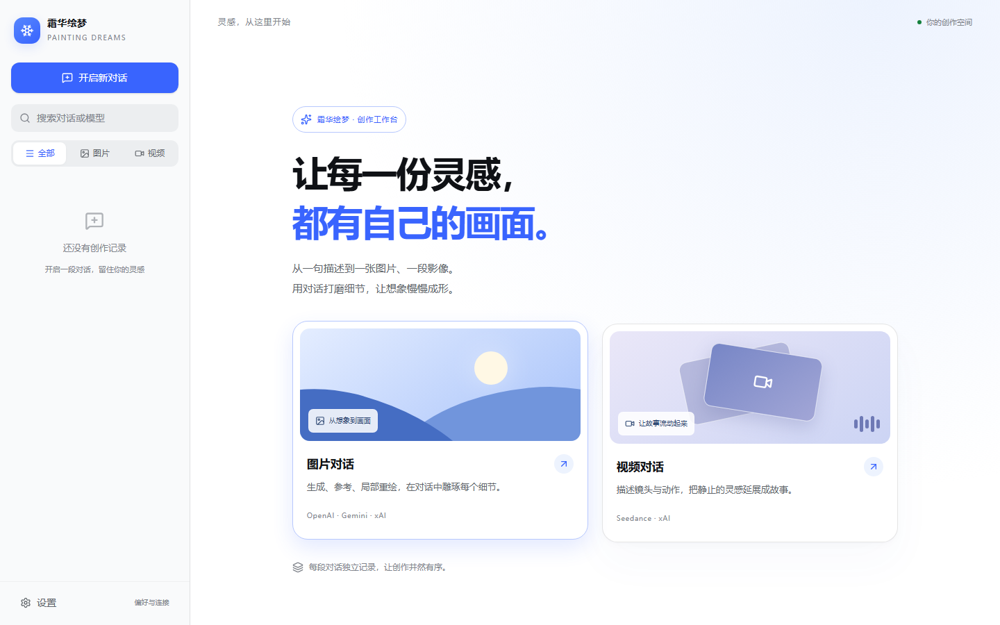
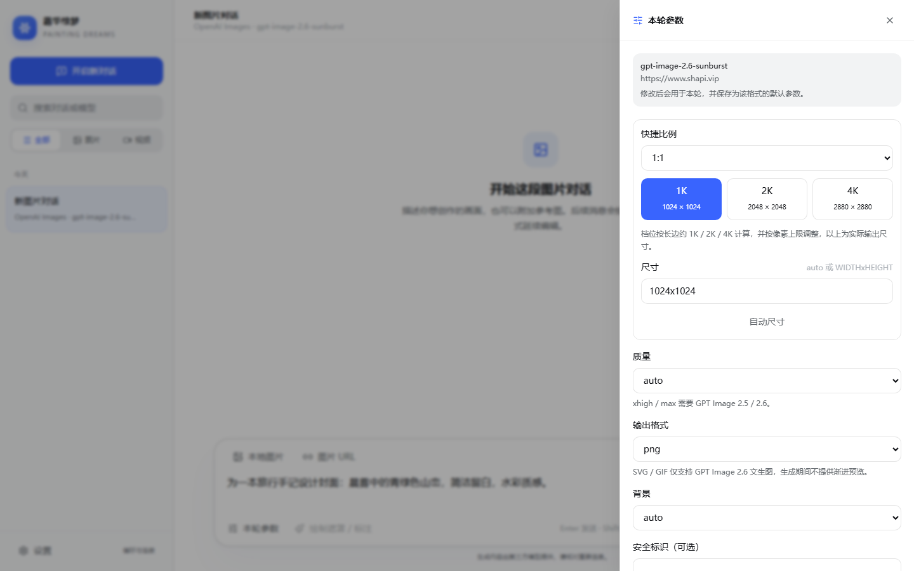
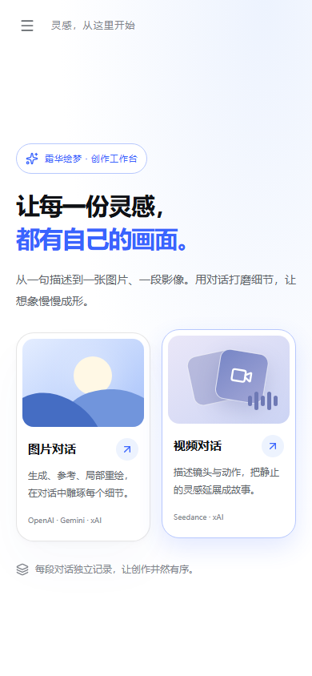

# 霜华绘梦

可自行部署的对话式 AI 图片与视频创作工具。在一个界面中连接不同供应商，通过对话生成图片、编辑细节、创建视频。



## 功能

- **图片创作**：文生图、参考图编辑、遮罩与标注编辑、渐进式预览，以及受支持模型的 SVG / GIF 输出。
- **视频创作**：文生视频、图片参考、任务进度查询，以及受支持模型的视频续写。
- **自由配置**：按接口设置 Base URL、API Key、模型列表与默认参数；模型名支持 `vendor/model`。
- **本地保存**：对话、图片与任务记录保存在当前浏览器，无需额外数据库服务。
- **桌面与手机**：自适应布局，支持浅色、深色和跟随系统主题。

| 类型 | 支持接口 |
| --- | --- |
| 图片 | OpenAI Images、OpenAI Responses、Google Gemini、xAI Image、字节 Seedream |
| 视频 | 字节 Seedance、xAI Video |

具体模型和功能以所连接的上游服务支持情况为准。

<details>
<summary>查看参数面板与手机界面</summary>

### 图片参数



### 手机首页



</details>

## 开始使用

服务器安装、端口访问、更新和删除，见 [部署教程](deploy/README.md)。

本机运行需准备 **Node.js 26 LTS（26.13.0+）、npm 12.2.2 和 uv 0.13.7+**；Python 3.15.2 由 uv 按项目配置安装。

```bash
git clone https://github.com/zhaibingye/shuanghua-painting-dreams.git
cd shuanghua-painting-dreams
npm run setup
npm start
```

打开 <http://localhost:3002>，填写 API Key；在「设置」中配置上游地址和模型，再创建图片或视频对话。

API Key 保存在当前浏览器，请求时经本服务转发给上游。清除网站数据会删除本地记录；更换浏览器、访问地址或端口后，原有数据不会自动共享。

## 开发

前端使用 React、TypeScript、Vite 和 Tailwind CSS，后端使用 FastAPI、Pydantic 和 aiohttp。生产模式由后端在同一端口提供页面与 API。

- `npm run dev`：启动开发环境，前端地址为 <http://localhost:5173>。
- `npm run check`：运行测试、静态检查与生产构建。
- `npm run e2e`：运行浏览器测试，首次运行前执行 `npm run e2e:install`。

[前端说明](frontend/README.md) · [后端说明](backend/README.md) · [Apache-2.0 许可证](LICENSE)
